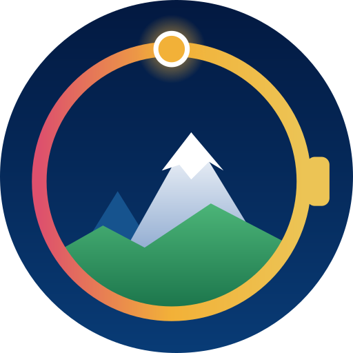

# WearMesh

<p align="center"></p>

A standalone Wear OS app for [MeshCore](https://docs.meshcore.io/) messaging from the wrist. The watch connects straight to a MeshCore companion radio over Bluetooth, with no phone in the loop, and handles channel and direct messages.

It is a [Colorado Mesh](https://coloradomesh.org/) project. Its protocol and Bluetooth code is shared with [MeshCore TAK Bridge](https://github.com/Colorado-Mesh/meshcore-tak-bridge) through [meshcore-kotlin](https://github.com/Colorado-Mesh/meshcore-kotlin), included here as a git submodule. How it is meant to work, and the plan, are in [docs/design.md](docs/design.md).

## Status

**M3 step 1: sending.** M0 (the Bluetooth spike), M1 (the shared meshcore-kotlin code) and M2 (a read-only client) are done; M2 carried the watch a full day in Check-in (about 1.5% battery an hour worn, 0.8% overnight) and a day in Live (about 2.0%), see [docs/M2-step5-carry.md](docs/M2-step5-carry.md). The `wear` app has its own screens (conversations with unread counts, a conversation view, radios, settings and diagnostics), notifies for direct messages, private channels and mentions, and runs in Live or Check-in mode; Settings › Quit WearMesh stops both until the app is opened again. M3 adds sending: step 1 stores sent messages with their status and sends them in either mode, with a test message from each conversation ([docs/M3-step1-sending.md](docs/M3-step1-sending.md)); the reply screens follow.

How to run the tests and what to record: [docs/M0-spike.md](docs/M0-spike.md) for the Live link, [docs/M2-step1-check-in.md](docs/M2-step1-check-in.md) for Check-in, [docs/M2-step2-storage.md](docs/M2-step2-storage.md) for storage, [docs/M2-step3-screens.md](docs/M2-step3-screens.md) for the screens, [docs/M2-step4-notifications.md](docs/M2-step4-notifications.md) for notifications and modes. The M2 plan is in [docs/design.md](docs/design.md).

## Layout

| Folder | What it holds |
| --- | --- |
| `meshcore-kotlin/` | A git submodule: the companion protocol in pure Kotlin, with its tests, and the Bluetooth link, shared with MeshCore TAK Bridge |
| `wear/` | The Wear OS app: Live and Check-in, in `data/` the message store and the sync step shared by both, in `ui/` the screens, and in `notify/` the notifications |
| `wear/schemas/` | The database schema of each version, written by Room during the build |
| `docs/` | The design proposal and the test procedures; `docs/icon/` has the icon and the script that draws it (`python3 docs/icon/make_icon.py` after changing it), plus `social-preview.png` for GitHub |

## Build

The shared code is a submodule, so clone with it:

```bash
git clone --recurse-submodules https://github.com/Colorado-Mesh/wearmesh.git
# or, in a clone made without it:
git submodule update --init
```

Then open the folder in Android Studio, or from a terminal:

```bash
./gradlew :wear:assembleDebug                    # wear/build/outputs/apk/debug/wear-debug.apk
./gradlew :wear:testDebugUnitTest                # the app's unit tests, the database's on Robolectric
./gradlew -p meshcore-kotlin :protocol:test      # the shared protocol's unit tests
```

To move to a newer version of the shared code: `git -C meshcore-kotlin pull origin main`, then commit the submodule change.

Install on a watch with wireless debugging on (Settings, Developer options, Wireless debugging):

```bash
adb pair <watch-ip>:<pairing-port>
adb connect <watch-ip>:<port>
adb install -r wear/build/outputs/apk/debug/wear-debug.apk
```

Needs JDK 17 and the Android SDK (compile SDK 35). The app runs on Wear OS 4 (API 33) and later.

## License

GPL-3.0, the same as MeshCore TAK Bridge. See [LICENSE](LICENSE).
